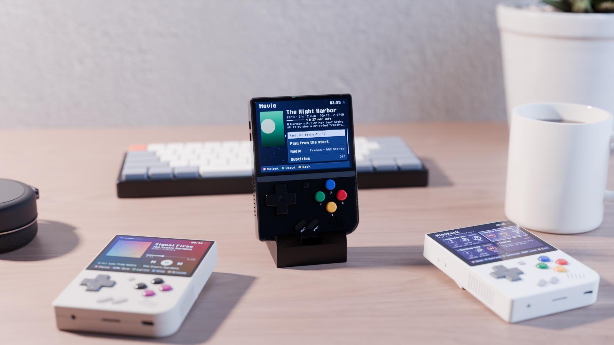
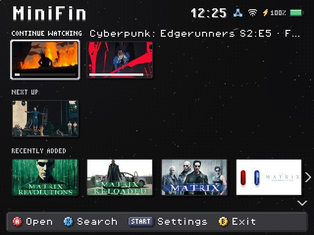
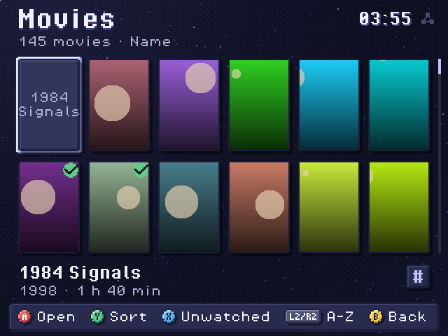
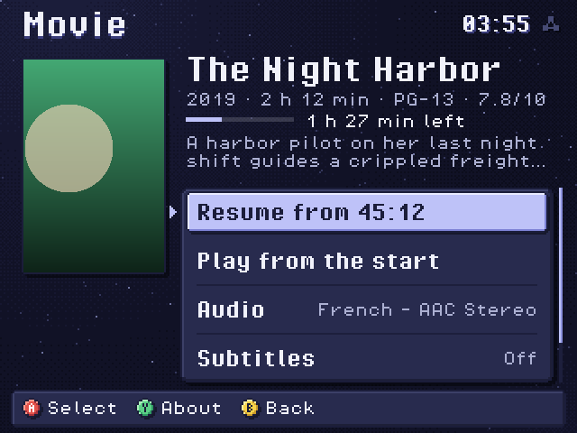

<p align="center"></p>

[](https://github.com/zakijss/MiniFin/actions/workflows/ci.yml)
[](https://github.com/zakijss/MiniFin/releases)
[](LICENSE)

# MiniFin

An unofficial [Jellyfin](https://jellyfin.org) client for movies and shows on a Miyoo Mini Plus. It is part of [MiniDeck](https://github.com/zakijss/MiniDeck). Music stays in [MiniTape](https://github.com/zakijss/MiniTape).

<p align="center">  </p>

- Finds your server without typing: servers on the Wi-Fi answer Jellyfin's discovery broadcast, and MiniFin asks each device on your tailnet (port 8096, and HTTPS on 443, 8920 and 8084). You can still pick a tailnet device or type the address.
- Signs in with Quick Connect: MiniFin shows a six-digit code, you approve it in Jellyfin on your phone, and you're in. A user name and password work too. Only the sign-in token is kept, sealed with the device key; the password is never stored.
- Home has rails for Continue Watching, Next Up, Recently Added and your libraries. Libraries open as a poster grid that only fetches the posters near the selection, so a library of 20,000 opens as fast as one of 20. **L2**/**R2** jump to the previous or next letter, **Y** changes the order and **X** hides what you've watched. Shows open to their seasons and episodes; **X** on Home searches.
- A video's page shows its facts, where you stopped, the overview (**Y** for all of it), and the audio and subtitle tracks (**Left**/**Right** change them).
- The server transcodes every video to what the device decodes smoothly: H.264 at up to 640x480 and 30 frames a second, with AAC stereo. **Settings > Streaming quality** sets the video at 0.6, 1.2 (the default) or 2 Mbit/s, about 320 MB, 590 MB or 950 MB an hour.
- Continue Watching stays in step: MiniFin tells the server when a video starts, every 10 seconds, on pause, after a seek and where it stops.
- When an episode ends, the next one starts after a 10-second countdown (**A** plays it at once, **B** stops). Offline, the next downloaded episode plays.
- Downloads keep a video on the card to watch offline: **Download** on its page, or **X** on an episode in a season. They check the free space first, and one that was interrupted goes on from where it stopped. When the server can't be reached MiniFin opens to the downloads, and positions from offline viewing go to the server the next time it answers.

## Using it

The first start looks for servers and signs in. **A** opens, **B** goes back, **START** on Home opens Settings, and **MENU** quits. On Home, **Y** reloads the rails. **X** on a video's page, or **Y** on a season's episodes, marks it watched or unwatched on the server (which clears where you were in it).

Videos play in minifin-player, MiniFin's own player, which decodes with the device's hardware decoder. It can seek within a stream: the server starts a new transcode at that point and stops the old one. The video's page says which player played it last, and whether it decoded in hardware or software. Without it, or if it can't start, MiniFin uses Onion's ffplay and says so on the video's page. In minifin-player, **A** pauses, **Left**/**Right** skip 10 seconds and **L1**/**R1** a minute, **Up**/**Down** set the volume, **Y** turns subtitles on and off, **X** changes the audio track and **SELECT** the subtitles (the video picks up where it was), **R2**/**L2** go to the next or previous episode (press twice), **START** keeps the overlay up, and **B** stops. With ffplay, **A** pauses, **B** or **MENU** stops, and subtitles are drawn into the picture by the server. Picture-based subtitles (PGS, VobSub) are always drawn in by the server.

Servers on your tailnet work through [MiniScale](https://github.com/zakijss/MiniScale). Settings also has the subtitle default, where downloads go (the app folder or `Videos/MiniFin` on the card), the player, clearing the cached posters, and the look of every MiniDeck app (**Appearance**).

## Install

- **MiniMart:** open [MiniMart](https://github.com/zakijss/MiniMart), then **Apps > MiniFin**. It checks the download and keeps your settings on updates.
- **Zip:** download `minifin-VERSION.zip` from [Releases](https://github.com/zakijss/MiniFin/releases/latest), unzip it onto the root of the SD card, and restart.

## Requirements

A Miyoo Mini Plus on Onion OS 4.4, with Wi-Fi. A Jellyfin server, 10.9 or later (Jellyfin 12 included), that is allowed to transcode video. Other devices and firmwares aren't supported.

## Building

```sh
make check                     # gofmt, vet, tests, scripts
make lint                      # staticcheck
make screens                   # every screen as a PNG, against a fake server
make package VERSION=1.0.0     # dist/: the release zip, app.json, SHA256SUMS
make deploy HOST=root@miyoo    # build and copy to a device over SSH
```

Go runs in Docker unless you pass `GO=go` (Go 1.27). The tests run against a fake Jellyfin that answers with the JSON of Jellyfin's API; nothing needs a real server. minifin-player is C and lives in `player/` (see its README); `make package` puts `player/build/minifin-player` into the zip when it has been built. The interface, themes and networking come from the [MiniDeck library](https://github.com/zakijss/MiniDeck); see its [development notes](https://github.com/zakijss/MiniDeck/blob/main/docs/DEVELOPMENT.md).

## License

The app is [MIT](LICENSE). minifin-player, the video player in `player/`, is a separate program under the [GPL, version 2 or later](player/LICENSE), because it links Onion's GPL build of FFmpeg; its source is in this repository, and the release zip carries both licences. Third-party components are listed in [NOTICE](NOTICE) and [player/NOTICE](player/NOTICE). MiniFin is not made by or affiliated with the Jellyfin project or Miyoo.
