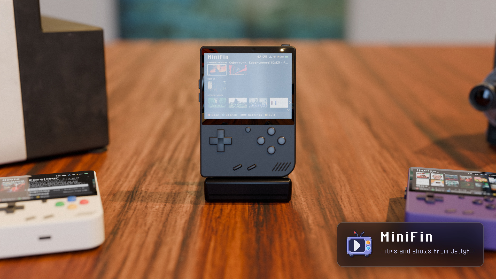
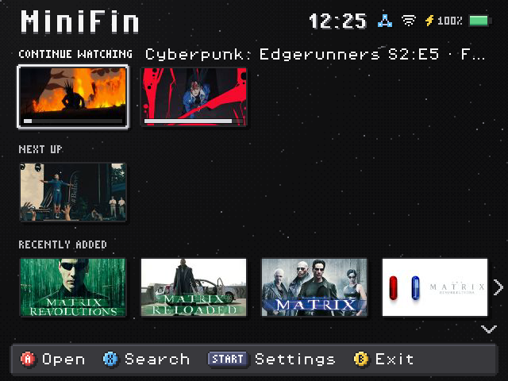
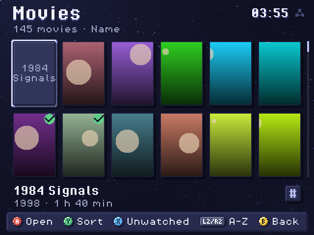
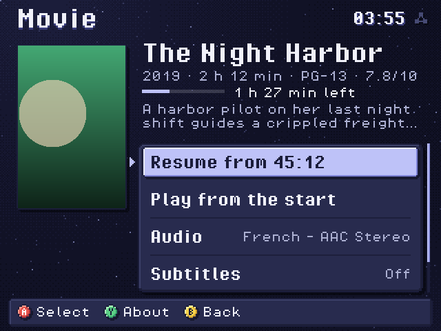

<p align="center"></p>

[](https://github.com/zakijss/MiniFin/actions/workflows/ci.yml)
[](https://github.com/zakijss/MiniFin/releases)
[](LICENSE)

# MiniFin

An unofficial [Jellyfin](https://jellyfin.org) client for movies and shows on a Miyoo Mini Plus, with hardware video decoding. Music stays in [MiniTape](https://github.com/zakijss/MiniTape). Part of [MiniDeck](https://github.com/zakijss/MiniDeck).

<p align="center">  </p>

- Finds your server on the Wi-Fi or your tailnet without typing, and signs in with Quick Connect: approve a six-digit code in Jellyfin on your phone. Only the sign-in token is kept, sealed with the device key; the password is never stored.
- Home has rails for Continue Watching, Next Up, Recently Added and your libraries. Libraries open as a poster grid that only fetches the posters near the selection, so a library of 20,000 opens as fast as one of 20.
- The server transcodes to what the device decodes smoothly: H.264 up to 640x480 at 30 frames a second, with AAC stereo, at 0.6, 1.2 (the default) or 2 Mbit/s (about 320, 590 or 950 MB an hour).
- Continue Watching stays in step with the server, and the next episode starts after a 10-second countdown with the audio and subtitle languages you picked.
- **Download** on a video's page keeps it on the card to watch offline; an interrupted download goes on where it stopped. When the server can't be reached MiniFin opens to the downloads, and positions from offline viewing go to the server the next time it answers.

## Install

Open [MiniMart](https://github.com/zakijss/MiniMart) and pick **Apps > MiniFin**: it checks the download and keeps your settings on updates. Or unzip `minifin-VERSION.zip` from [Releases](https://github.com/zakijss/MiniFin/releases/latest) onto the root of the SD card and restart. Every MiniDeck app comes in one zip too: [minideck-all.zip](https://github.com/zakijss/MiniDeck/releases/latest/download/minideck-all.zip).

Needs a Miyoo Mini Plus on Onion OS 4.4, with Wi-Fi, and a Jellyfin server, 10.9 or later (Jellyfin 12 included), that is allowed to transcode video. Other devices and firmwares aren't supported. Servers on your private network (Tailscale, Headscale, WireGuard or NetBird) work through [MiniScale](https://github.com/zakijss/MiniScale).

## Using it

The first start looks for servers (Jellyfin's discovery broadcast on the Wi-Fi, and port 8096, or HTTPS on 443, 8920 and 8084, on each tailnet device) and signs in; you can also pick a tailnet device or type the address. A user name and password work too.

- **A** opens, **B** goes back, **START** on Home opens Settings and **MENU** quits.
- On Home, **Y** reloads the rails and **X** searches.
- In a library, **L2**/**R2** jump to the previous or next letter, **Y** changes the order and **X** hides what you've watched.
- On a video's page, **Left**/**Right** change the audio and subtitle tracks, **Y** shows the whole overview and **X** marks it watched or unwatched on the server (which clears where you were in it). **Y** does the same on a season's episodes, and **X** there downloads one.
- During the next-episode countdown, **A** plays it at once and **B** stops.

Videos play in minifin-player, MiniFin's own player, which uses the device's hardware decoder and can seek within a stream (the server starts a new transcode at that point). If it can't start, MiniFin uses Onion's ffplay and says so; the video's page shows which player played it last, in hardware or software. Picture-based subtitles (PGS, VobSub), and every subtitle under ffplay, are drawn into the picture by the server.

<details>
<summary><b>Player controls</b></summary>

| minifin-player | |
|---|---|
| A | pause |
| Left / Right | skip 10 seconds |
| L1 / R1 | skip a minute |
| Up / Down | volume |
| Y | subtitles on or off |
| X / SELECT | audio track / subtitle track |
| L2 / R2 | previous / next episode (press twice) |
| START | keep the overlay up |
| B | stop |

In ffplay, **A** pauses and **B** or **MENU** stops.

</details>

**Settings** has the streaming quality, the subtitle default, where downloads go (the app folder or `Videos/MiniFin` on the card), the player, clearing the cached posters, and **Appearance** for every MiniDeck app.

## Building

```sh
make check                     # gofmt, vet, tests, scripts
make lint                      # staticcheck
make screens                   # every screen as a PNG, against a fake server
make package VERSION=1.0.0     # dist/: the release zip, app.json, SHA256SUMS
make deploy HOST=root@miyoo    # build and copy to a device over SSH
```

Go runs in Docker unless you pass `GO=go` (Go 1.27). The tests run against a fake Jellyfin that answers with the JSON of Jellyfin's API; nothing needs a real server. minifin-player is C and lives in `player/` (see its README); `make package` puts `player/build/minifin-player` into the zip when it has been built. The interface, themes and networking come from the [MiniDeck library](https://github.com/zakijss/MiniDeck); see its [development notes](https://github.com/zakijss/MiniDeck/blob/main/docs/DEVELOPMENT.md).

## License

The app is [MIT](LICENSE). minifin-player, the video player in `player/`, is a separate program under the [GPL, version 2 or later](player/LICENSE), because it links Onion's GPL build of FFmpeg; its source is in this repository, and the release zip carries both licences. Third-party components are listed in [NOTICE](NOTICE) and [player/NOTICE](player/NOTICE). MiniFin is not made by or affiliated with the Jellyfin project or Miyoo.
